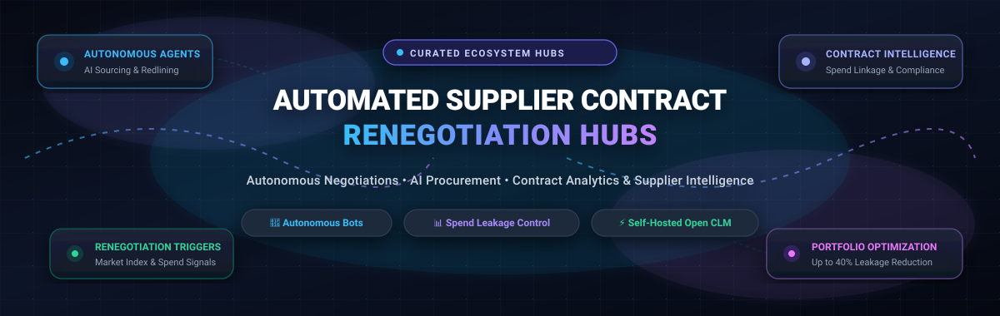

<p align="center">
  
</p>

<p align="center">
  <a href="https://github.com/ishandutta2007/Awesome-Awesome-Awesome"></a><a href="https://discord.gg/jc4xtF58Ve"></a>
  <a href="https://github.com/ishandutta2007/Awesome-Automated-Supplier-Contract-Renegotiation-HUBS/stargazers"></a>
  <a href="https://github.com/ishandutta2007/Awesome-Automated-Supplier-Contract-Renegotiation-HUBS/network/members"></a>
  <a href="https://github.com/ishandutta2007/Awesome-Automated-Supplier-Contract-Renegotiation-HUBS/pulls"></a>
  <a href="https://github.com/ishandutta2007/Awesome-Automated-Supplier-Contract-Renegotiation-HUBS/blob/main/LICENSE"></a>
  <a href="https://github.com/ishandutta2007/Awesome-Automated-Supplier-Contract-Renegotiation-HUBS/commits/main"></a>
  <a href="https://github.com/ishandutta2007"></a>
</p>

---

# 🤖 Awesome Automated Supplier Contract Renegotiation Hubs 📋

> ⚡ **A curated directory of Autonomous Negotiation Bots, AI-Powered Sourcing Platforms, Spend Analytics Engines, and Open-Source Contract Lifecycle Management (CLM) Ecosystems.**

*Focused on Autonomous B2B Negotiation, Supplier Intelligence, Spend Leakage Control, and Real-Time Renegotiation Triggers.*

**Last updated: March 2026** 📅

This repository tracks the leading **enterprise SaaS platforms** and **open-source GitHub projects** driving the **Automated Supplier Contract Renegotiation** revolution. These cutting-edge systems empower enterprise procurement teams, supply chain executives, and contract managers to automate supplier communications, negotiate unit rates and commercial terms autonomously at scale, and initiate dynamic renegotiations triggered by market price shifts, ERP spend leakage, and macro supplier performance signals.

---

## 📑 Table of Contents

- [🌐 Sector Overview & Market Dynamics](#-sector-overview--market-dynamics)
- [🏢 SaaS & Hosted Platforms](#-saas--hosted-platforms)
  - [📊 SaaS Comparison Matrix](#-saas-comparison-matrix)
  - [🔍 In-Depth Platform Analysis](#-in-depth-platform-analysis)
- [💻 Open-Source GitHub Projects](#-open-source-github-projects)
  - [⭐ Ranked by GitHub Stars](#-ranked-by-github-stars)
  - [🏗️ Self-Hosted Architecture Blueprint](#-self-hosted-architecture-blueprint)
- [⭐ Star History](#-star-history)
- [💖 Support & Community](#-support--community)
- [🤝 How to Contribute](#-how-to-contribute)
- [⚠️ Disclaimer](#-disclaimer)

---

## 🌐 Sector Overview & Market Dynamics

The global procurement software and Contract Lifecycle Management (CLM) market reached an estimated valuation of **$8.2 Billion in 2024–2025** and is projected to expand to **$17.5 Billion by 2030 at a CAGR of 11.8%**, with the specialized sub-segment of **autonomous AI negotiation and algorithmic sourcing surging at over 28% CAGR**. 

The sector is **moderately fragmented**: while legacy Enterprise Resource Planning (ERP) and Source-to-Pay (S2P) mega-conglomerates (such as SAP, Coupa, Workday, and Ivalua) anchor core transaction volumes, the rapid rise of purpose-built autonomous negotiation bots (e.g., Pactum AI, Keelvar, Fairmarkit) has prevented a "winner-take-all" monopoly. Enterprise procurement organizations increasingly adopt a **composable best-of-breed architecture**, pairing centralized ERP backbones with autonomous negotiation engines that systematically recover the 10%–40% in contract value leakage traditionally lost across unmanaged tail spend.

---

## 🏢 SaaS & Hosted Platforms

### 📊 SaaS Comparison Matrix

The table below benchmarks enterprise SaaS solutions for automated supplier negotiation and contract management. Companies are **sorted in descending order by corporate scale (Valuation / Revenue)**.

| 🏢 Platform | 📊 Company Scale (Valuation / Revenue) | 💰 Specific Starting Pricing | 🎁 Free Tier / Trial Limits | 🚀 Renegotiation Focus & Capabilities |
| :--- | :--- | :--- | :--- | :--- |
| **[Suplari](https://suplari.com/)** | **$3.1T Parent Market Cap** (Microsoft) / ~$50M Standalone Valuation ($50B+ spend analyzed) | **Starts at $46,000/year** (Average contract base tier; scales with data connectors) | **30-day proof-of-concept pilot** upon qualification (limited to 2 data sources and up to 500 supplier invoice line items) | AI Digital Workers track maverick spend, license creep, and renewal patterns to trigger contract renegotiations. |
| **[Scout RFP (Workday Strategic Sourcing)](https://www.workday.com/)** | **~$70.0B Market Cap** (Workday NASDAQ: WDAY) / ~$7.3B Revenue ($540M acquisition) | **Starts at $36,000/year** (Billed annually for core strategic sourcing module) | **30-day sandbox pilot** via sales consultation (limited to 3 test RFx events and up to 5 supplier participants) | Programmatic Award Line Items API, automated supplier bidding intake, and enterprise intake pipeline management. |
| **[Coupa](https://www.coupa.com/)** | **$8.0B Valuation** (Acquired by Thoma Bravo) / ~$830M Revenue | **Starts at $21,000/year** (Core procurement starter; median enterprise deployment ~$94,500/year) | **14-day guided sandbox access** after enterprise demo (limited to pre-loaded sample spend data and 2 test approvals) | AI Contract Intelligence extracting multi-clause risks across an $8T transaction dataset to prompt renegotiation windows. |
| **[GEP SMART](https://www.gep.com/)** | **~$2.8B Est. Valuation** (Global Supply Chain Leader) / ~$400M Revenue | **Starts at $75,000/year** (Base AI spend and sourcing module, multi-year commitment) | **30-day scoped enterprise pilot** post-evaluation (restricted to 1 spend category and max 20 supplier profiles) | AI-first Source-to-Contract (S2C) suite unifying contract variance alerts, project savings tracking, and automated renewals. |
| **[Jaggaer](https://www.jaggaer.com/)** | **$1.5B Valuation** (Acquired by Cinven) / ~$300M Revenue | **Starts at $75,000/year** (Entry-level S2C module package for up to 5 users, billed annually) | **30-day scoped pilot evaluation** upon qualification (limited to 1 contract template and 10 simulated supplier records) | 30+ years supplier intelligence ecosystem with ESG scoring, fraud monitoring, and automated vendor performance renewals. |
| **[Ivalua](https://www.ivalua.com/solutions/process/source-to-contract/)** | **$1.1B+ Valuation** (Unicorn status, backed by KKR) / ~$180M Revenue | **Starts at $150,000/year** (Base enterprise cloud subscription tier) | **30-day guided interactive PoC sandbox** after technical scoping (limited to 5 user logins and sample supplier dataset) | Intelligent Virtual Agent (IVA) providing conversational contract audits, governed autonomy, and unified S2C workflows. |
| **[Fairmarkit](https://www.fairmarkit.com/platform/platform-overview)** | **~$280M Valuation** ($78M raised, Series C) / ~$25M ARR | **Starts at $50,000/year** (Or ~$50–$200/user/month depending on tail-spend volume) | **14-day interactive pilot trial** on request (limited to 5 mock RFQs and 1 ERP sandbox connection) | Autonomous multi-agent sourcing (KIT) auto-competing renewals, tail-spend intake, and scenario-based bid award closure. |
| **[Keelvar](https://www.keelvar.com/)** | **~$180M Valuation** ($43M raised, Bain Capital) / ~$18M ARR | **Starts at $60,000/year** (Sourcing Optimizer Tier 1 on SAP Store, 5 users, 1-year contract) | **30-day enterprise Proof-of-Concept pilot** (limited to 1 sourcing event and up to 25 vendor participants) | AI-native autonomous sourcing bots optimizing $100B+ spend with mathematical optimization for freight, MRO, and services. |
| **[Pactum AI](https://pactum.com/)** | **~$175M Valuation** ($54M raised, Atomico/3L) / ~$12M ARR | **Starts at $75,000/year platform fee** + value-share (typically 10%–15% of verified supplier savings) | **60-day targeted pilot campaign** (restricted to 1 supplier cohort of up to 50 tail-spend vendors) | Autonomous negotiation category creator; conversational AI bots negotiating payment terms and unit costs via chat/email. |
| **[Sievo](https://sievo.com/products/contract-analytics)** | **~$140M Valuation** (Leading European Procurement Analytics) / ~$35M ARR | **Starts at $80,000/year** (Procurement analytics starter tier for spend up to $1B) | **30-day data-readiness assessment trial** (limited to 1 ERP data extract and 1,000 transaction line items) | Contract-to-spend analytics identifying maverick leakage, expiration exposure, and benchmarking same-category vendors. |

---

### 🔍 In-Depth Platform Analysis

#### 🤖 1. [Pactum AI](https://pactum.com/) — *Autonomous Negotiations Pioneer*
- **Category Leadership:** Creator of the **Autonomous Negotiations** category in 2019.
- **Workflow:** Deploys conversational AI agents that proactively reach out to suppliers via email/web chat to conduct multi-turn commercial renegotiations without human intervention.
- **Preparation & Execution:** Conducts the equivalent of **100 human hours of preparation** per deal by analyzing historical purchase orders, market price indices, and target margin boundaries.
- **Tactical Sourcing v2.0:** Features vendor aggressiveness tuning, dynamic term valuations, and out-of-the-box connectors for SAP Ariba, Coupa, and SAP S/4HANA across 40+ languages.

#### ⚡ 2. [Fairmarkit](https://www.fairmarkit.com/) — *Multi-Agent Sourcing Automation*
- **Agent Ecosystem:** Powered by **KIT**, an ensemble of specialized procurement agents:
  - **Intake Agent:** Structures compliant requests directly from internal requisitioners.
  - **Supplier Discovery Agent:** Identifies qualified suppliers and automatically re-competes renewals.
  - **Evaluation Agent:** Executes side-by-side bid comparisons and autonomous renegotiation closure.
- **Demonstrated Impact:** Reduces demand-to-award cycle times by **86%**, saving 500+ hours per SOW and increasing buyer event capacity by 300%.

#### 📊 3. [Sievo](https://sievo.com/products/contract-analytics) — *Spend & Contract Variance Analytics*
- **Contract-to-Spend Linkage:** Solves contract value leakage (often reaching **up to 40%**) by unifying ERP purchase records with executed legal agreements.
- **Renewal Prioritization:** Ranks upcoming contract expiries by annualized spend exposure, highlighting unfavorable payment terms and maverick purchasing.
- **Category Benchmarking:** Correlates terms between same-category suppliers to uncover pricing anomalies and trigger re-contracting events.

#### 🧮 4. [Keelvar](https://www.keelvar.com/) — *Algorithmic Sourcing Optimization*
- **Enterprise Scale:** Optimizes over **$100 Billion in annual spend** for global enterprises in transportation logistics, packaging, and indirect procurement.
- **Optimization Algorithms:** Originated from PhD game-theory research at University College Cork; combines combinatorial auction algorithms with autonomous sourcing bots.
- **ISO Certified:** ISO 27001 and 27701 certified enterprise platform natively available via the SAP Store.

#### 🌐 5. [Coupa](https://www.coupa.com/) — *Enterprise Business Spend Management (BSM)*
- **Global Data Advantage:** Leverages an **$8 Trillion anonymized spend dataset** spanning 10M+ buyers and global suppliers to surface renegotiation benchmarks.
- **Contract Intelligence:** Automatically digests PDF and scanned contracts to identify non-standard indemnities, missing rebates, and pricing tiers.
- **Supply Chain Orchestration:** Integrates Services Maestro and purchase order collaboration to automatically track compliance against negotiated contracts.

#### 🛡️ 6. [Ivalua](https://www.ivalua.com/solutions/process/source-to-contract/) — *Source-to-Contract with Governed Autonomy*
- **IVA (Intelligent Virtual Agent):** Conversational AI copilot assisting procurement teams in reviewing contract milestones and drafting amendments.
- **Governed Autonomy:** Enforces organizational compliance by ensuring autonomous agent proposals adhere strictly to corporate governance rules.
- **Industry Recognition:** Gartner Magic Quadrant Leader for Source-to-Pay Suites with documented 10x ROI implementations.

#### 📈 7. [GEP SMART](https://www.gep.com/) — *Unified Procurement & Supply Chain Platform*
- **Cloud-Native AI Architecture:** Seamlessly connects upstream sourcing and contract authoring with downstream procure-to-pay execution.
- **Savings Pipeline Tracker:** Monitors real-time contract compliance against projected savings targets, highlighting variance that warrants supplier renegotiation.

#### 🏆 8. [Jaggaer](https://www.jaggaer.com/) — *Supplier Intelligence & ESG Orchestration*
- **Deep Supplier Footprint:** Built on 30+ years of enterprise supplier data trusted by 75% of leading research universities.
- **Autonomous Commerce:** Employs AI-driven supplier risk monitoring, automated vendor development plans, carbon emissions tracking, and contract milestone alerts.

#### 💡 9. [Suplari](https://suplari.com/) — *AI Spend Intelligence (Microsoft)*
- **Continuous Intelligence:** AI agents and digital workers ingest enterprise accounting records to flag software license shelfware, duplicate vendor charges, and auto-renewals.
- **Rapid Time-to-Value:** Shortens the intelligence-to-decision cycle from quarters to hours, delivering continuous renegotiation triggers.

#### 🤝 10. [Scout RFP (Workday Strategic Sourcing)](https://www.workday.com/) — *Collaborative Sourcing Engine*
- **Workday Spend Integration:** Programmatic REST APIs enable real-time tracking of procurement awards, RFx bids, supplier scorecards, and rate sheets.
- **Automated Sourcing Pipeline:** Centralizes supplier intake and project bidding to drive competitive supplier tension during contract renewals.

---

## 💻 Open-Source GitHub Projects

Open-source tools offer complete architectural freedom, vendor independence, and data privacy for teams building self-hosted autonomous negotiation pipelines.

### ⭐ Ranked by GitHub Stars

Below are open-source repositories suitable for constructing supplier contract management, e-procurement, and automated renegotiation platforms, **sorted in descending order by GitHub Stars**:

| 📦 Repository & Stars | 🏷️ License | 🛠️ Technology Stack | 🎯 Role in Automated Renegotiation Hub |
| :--- | :--- | :--- | :--- |
| **[n8n](https://github.com/n8n-io/n8n)**<br/>[](https://github.com/n8n-io/n8n/stargazers) | `Sustainable Use / Fair-code` | TypeScript / Node.js | **Renegotiation Workflow Orchestration:** Connects ERP webhooks, supplier notification triggers, LLM agents, and approval slack bots. |
| **[Odoo Purchase](https://github.com/odoo/odoo)**<br/>[](https://github.com/odoo/odoo/stargazers) | `LGPL-3.0` | Python / JavaScript | **Core Procurement & Vendor Master:** Manages purchase orders, automated RFQ dispatches, vendor rate agreements, and price lists. |
| **[Paperless-ngx](https://github.com/paperless-ngx/paperless-ngx)**<br/>[](https://github.com/paperless-ngx/paperless-ngx/stargazers) | `GPL-3.0` | Python / Django / OCR | **Supplier Contract Repository & OCR:** Ingests executed supplier agreements, extracts text with OCR, tags terms, and indexes metadata. |
| **[ERPNext Buying](https://github.com/frappe/erpnext)**<br/>[](https://github.com/frappe/erpnext/stargazers) | `GPL-3.0` | Python / Frappe | **Supplier Lifecycle & Quotation Management:** Tracks supplier scorecards, purchase contracts, blanket orders, and pricing matrices. |
| **[Documenso](https://github.com/documenso/documenso)**<br/>[](https://github.com/documenso/documenso/stargazers) | `AGPL-3.0` | TypeScript / Next.js / Prisma | **Open-Source E-Signature Infrastructure:** Cryptographically signs and seals finalized renegotiated contract amendments and SOWs. |
| **[Invoice Ninja](https://github.com/invoiceninja/invoiceninja)**<br/>[](https://github.com/invoiceninja/invoiceninja/stargazers) | `FSL-1.1-Apache-2.0` | PHP / Laravel / Flutter | **Vendor Payment & Expense Tracking:** Audits unit prices on incoming vendor invoices against agreed contract rate cards. |
| **[InvenTree](https://github.com/inventree/InvenTree)**<br/>[](https://github.com/inventree/InvenTree/stargazers) | `MIT` | Python / Django | **Supplier Parts & Quantity Price Breaks:** Tracks supplier manufacturer parts, bulk cargo price tiers, and inventory replenishment signals. |
| **[OpenContracts](https://github.com/Open-Source-Legal/OpenContracts)**<br/>[](https://github.com/Open-Source-Legal/OpenContracts/stargazers) | `Apache-2.0` | Python / Django / React | **Document Intelligence & AI Parsing:** Extracts contract clauses, payment terms, auto-renewal dates, and liability caps using LLMs. |
| **[OpenKM](https://github.com/openkm/document-management-system)**<br/>[](https://github.com/openkm/document-management-system/stargazers) | `GPL-2.0` | Java / Spring | **Enterprise Contract Records Management:** Manages document version history, approval routing, access controls, and audit trails. |
| **[Cicero (Accord Project)](https://github.com/accordproject/cicero)**<br/>[](https://github.com/accordproject/cicero/stargazers) | `Apache-2.0` | TypeScript / JavaScript | **Computable Smart Legal Contracts (Linux Foundation):** Turns natural-language contract clauses into executable code with dynamic parameters. |
| **[Alfresco Community](https://github.com/Alfresco/alfresco-community-repo)**<br/>[](https://github.com/Alfresco/alfresco-community-repo/stargazers) | `LGPL-3.0` | Java / Maven | **Enterprise Content Management:** High-volume contract archive, workflow automation, and compliant records retention. |
| **[OCDS Standard Schema](https://github.com/open-contracting/standard)**<br/>[](https://github.com/open-contracting/standard/stargazers) | `Apache-2.0` | JSON Schema / Python | **Standard Data Exchange Schema:** Global standard for structuring public and private procurement tenders, awards, and contracts. |
| **[Prozorro (OpenProcurement API)](https://github.com/openprocurement/openprocurement.api)**<br/>[](https://github.com/openprocurement/openprocurement.api/stargazers) | `Apache-2.0` | Python / Cornice / CouchDB | **Transparent Bidding & Auction Engine:** Powers Ukraine's e-procurement reform; saved over $6B in public funds through open auctioning. |
| **[draftLegal](https://github.com/AniketTati/draft-legal)**<br/>[](https://github.com/AniketTati/draft-legal/stargazers) | `MIT` | TypeScript / Python / Docker | **Agentic AI Contract Redlining:** Self-hosted Harvey/Ironclad alternative with 8 specialist agents proposing automated counter-redlines. |
| **[Procurelytics AI](https://pypi.org/project/procurelytics-ai/)**<br/>*(PyPI Python Library)* | `MIT` | Python / ML | **Predictive Sourcing & Spend Analytics:** Generates supplier risk metrics, process mining variants, and LLM-ready procurement prompts. |

---

### 🏗️ Self-Hosted Architecture Blueprint

Enterprise engineering teams can combine these open-source building blocks into a private, cost-effective, and fully sovereign **Automated Supplier Contract Renegotiation Hub**:

```text
  ┌─────────────────────────────────────────────────────────────┐
  │                 1. SOURCING INGESTION & DATA                │
  │   Odoo / ERPNext (Spend Logs) + Paperless-ngx (Agreements)  │
  └──────────────────────────────┬──────────────────────────────┘
                                 │
                                 ▼
  ┌─────────────────────────────────────────────────────────────┐
  │            2. INTELLIGENCE & RENEGOTIATION SIGNALS          │
  │   OpenContracts (Clause Extraction) + Procurelytics AI      │
  │     - Identifies expired contracts & unfavorable terms      │
  │     - Flags >15% commodity/market price variances           │
  └──────────────────────────────┬──────────────────────────────┘
                                 │
                                 ▼
  ┌─────────────────────────────────────────────────────────────┐
  │          3. AUTONOMOUS NEGOTIATION & REDLINE AGENTS         │
  │       draftLegal (8 Specialist Agents) + Cicero Rules       │
  │     - Generates conservative / moderate / aggressive terms  │
  │     - Drafts standardized contract amendment clauses        │
  └──────────────────────────────┬──────────────────────────────┘
                                 │
                                 ▼
  ┌─────────────────────────────────────────────────────────────┐
  │              4. ORCHESTRATION & FINAL SIGN-OFF              │
  │      n8n (Supplier Email/Chat) + Documenso (E-Signature)    │
  │     - Dispatches renegotiation proposals via email          │
  │     - Logs audit trail and stores finalized signed PDF      │
  └─────────────────────────────────────────────────────────────┘
```

---

## ⭐ Star History

[](https://star-history.dera.page/#ishandutta2007/Awesome-Automated-Supplier-Contract-Renegotiation-HUBS&type=date&legend=top-left)

---

## 💖 Support & Community

Thank you for exploring the **Awesome Automated Supplier Contract Renegotiation Hubs** repository! 

If this curated guide helps your organization unlock savings, automate manual contract reviews, or build next-generation procurement agents, please consider showing your support:

- ⭐ **Star this repository** on GitHub to help other procurement and engineering teams discover it.
- 🍴 **Fork the project** and contribute insights, platform updates, or open-source additions.
- 📢 **Share the link** across your professional network on [LinkedIn](https://linkedin.com) and [Twitter / X](https://twitter.com).
- ☕ **Support the maintainer** with a virtual coffee on the **[GitHub Sponsor Dashboard](https://github.com/sponsors/ishandutta2007)**!

---

## 🤝 How to Contribute

Contributions are warmly welcomed! To suggest a new SaaS platform or open-source repository:

1. **Fork** the repository to your own GitHub account.
2. **Create a descriptive feature branch**: `git checkout -b add-new-platform`.
3. **Add or update the platform**:
   - For SaaS tools: Include specific starting pricing, detailed free tier / trial terms, company valuation/revenue, and autonomous renegotiation capabilities.
   - For open-source tools: Include the official repository link, star badge, license, and stack details.
4. **Follow the formatting guidelines**: Keep listings objective, verifiable, and alphabetically or hierarchically sorted.
5. **Submit a Pull Request** with a brief summary of the proposed addition.

---

## ⚠️ Disclaimer

- This repository is a **community-curated research directory** created for educational, analytical, and architectural purposes. Inclusion does not imply formal endorsement.
- Automated supplier negotiations and pricing agreements must strictly comply with applicable trade regulations, antitrust laws, and enterprise data privacy standards (including GDPR, CCPA, and SOC 2).
- Contract and pricing information is commercially sensitive. When evaluating third-party LLMs or deploying self-hosted agents, ensure appropriate data boundaries are enforced to prevent data leakage into public training sets.
